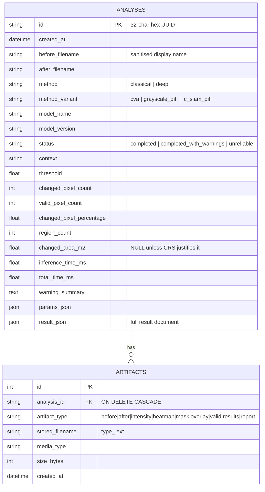

# Architecture

## Components

```
project-orbit/
├── backend/
│   ├── app/
│   │   ├── main.py              FastAPI app factory, CORS, access-log middleware, lifespan (DB + model load)
│   │   ├── api/
│   │   │   ├── system.py        /health, /models, /samples
│   │   │   ├── analyses.py      /analyze, /analyze/batch, /analyses..., /evaluate
│   │   │   └── deps.py          upload reading with byte limits, params parsing, store dependency
│   │   ├── core/                config (env vars), errors (+ handlers), logging
│   │   ├── database/            SQLAlchemy models + session/engine
│   │   ├── schemas/             Pydantic request/response models
│   │   ├── models/              FC-Siam-diff network, checkpoint format, dataset loader
│   │   ├── services/
│   │   │   ├── image_io.py      validation + decoding
│   │   │   ├── geo.py           CRS metadata, reprojection, area
│   │   │   ├── alignment.py     registration + radiometric normalisation
│   │   │   ├── classical.py     baseline change detection + mask post-processing
│   │   │   ├── deep.py          model service (load, status, tiled inference)
│   │   │   ├── metrics.py       statistics + evaluation metrics
│   │   │   ├── interpretation.py rules-based "disaster intelligence"
│   │   │   ├── visualization.py heatmap / overlay rendering
│   │   │   ├── storage.py       artifact store with path-traversal protection
│   │   │   ├── report.py        PDF report
│   │   │   └── pipeline.py      orchestration + re-thresholding
│   │   └── utils/synthetic.py   procedural synthetic scenes (tests, samples, smoke training)
│   ├── scripts/                 make_samples, prepare_dataset, train, evaluate
│   └── tests/                   pytest suite
├── frontend/src/
│   ├── pages/                   Landing, Analyze (dashboard), History, Methodology
│   ├── components/              viewer, swipe, panels, upload, UI primitives
│   ├── services/api.ts          typed API client
│   ├── hooks/useBackend.ts      health/model polling
│   └── utils/                   formatting, client-side thresholding
├── data/samples/                bundled synthetic pairs + manifest
├── data/checkpoints/            (empty) trained weights go here
└── artifacts/                   runtime output (SQLite DB + per-analysis folders)
```

## Request lifecycle: `POST /api/analyze`

1. **Route** (`api/analyses.py`): parses `params` into `AnalysisParams` (unknown fields are rejected). It reads each
   upload with a hard limit of `max_upload_bytes + 1`. The CPU-bound pipeline runs in a thread pool so the event loop
   stays responsive.
2. **Guard**: if `method=deep` and no model is loaded, the request stops with **409**. The classical method is never
   substituted.
3. **Concurrency**: a bounded semaphore (`ORBIT_MAX_CONCURRENT_ANALYSES`) protects memory. If no slot frees up within
   120 s, the request gets 503.
4. **Ingest** (`image_io.load_image`): magic-byte sniffing, Pillow `verify()` plus a full decode, pixel budget,
   alpha/nodata validity mask, and stretching of high-bit-depth images to 8-bit.
5. **Prepare pair** (`alignment.prepare_pair`): reproject (geo) → resize (warn) → downscale (cap) → register (ORB/ECC
   with sanity checks) → valid mask → normalise radiometry. The result includes a `reliable` flag and warnings.
6. **Detect**: classical intensity in [0, 1], or the model's probability map. Values are quantised to 1/255 so the
   stored 8-bit `intensity.png` reproduces the exact same mask when re-thresholded later.
7. **Finalize**: threshold → morphology → min-region filter → statistics → area → interpretation.
8. **Persist**: PNG artifacts and a `results.json` are written atomically (temp file + rename) under a random name.
   Then the DB row is committed. If anything fails, the DB transaction is rolled back **and** the analysis folder is deleted.

Re-thresholding (`POST /api/analyses/{id}/rethreshold`) reads `intensity.png` and `valid.png`, reruns steps 7–8,
replaces the mask, overlay and results artifacts, and invalidates the cached PDF. It never reruns registration or the
model. The frontend also previews thresholds instantly by thresholding `intensity.png` on a `<canvas>`.

## Data model (SQLite via SQLAlchemy)



Image binaries are never stored in the database, only random file names inside the artifact directory.

**Initialisation / migrations.** `init_db()` calls `Base.metadata.create_all()` at startup, which is idempotent and
creates tables that are missing. For schema *changes* in a deployed system, add Alembic:
`pip install alembic && alembic init migrations`. Point `env.py` at `app.database.models.Base.metadata`, then use
`alembic revision --autogenerate -m "..."` and `alembic upgrade head`. For a local project you can also delete
`artifacts/orbit.db` and its analyses folder to start fresh.

**Deletion behaviour.** `DELETE /api/analyses/{id}` deletes the `analyses` row; artifact rows are removed by cascade.
It then recursively deletes `artifacts/analyses/<id>/`. Original uploads are never written to disk: they are decoded
in memory, and Starlette's spooled temp files are closed after reading. That means nothing else needs cleaning up.

## Security measures

| Threat | Mitigation |
|---|---|
| Malicious or oversized upload | byte limit while reading; magic-byte type check; `Image.MAX_IMAGE_PIXELS` + decompression-bomb warning treated as an error; minimum and maximum dimensions |
| Path traversal | IDs must match `^[0-9a-f]{32}$`; clients request artifact *types*, never names; stored names are regex-checked; resolved paths must stay inside the artifact root; sample files only come from the manifest |
| Information leakage | uniform error JSON; the generic 500 handler hides exception details; display names are sanitised (directories stripped) |
| Pickle code execution | `torch.load(..., weights_only=True)` |
| Cross-origin abuse | CORS allow-list from `ORBIT_ALLOWED_ORIGINS`; a warning is logged if `*` is used |
| Resource exhaustion | processing-size cap, concurrency semaphore, batch-size cap |

Not implemented (needed before a public multi-user deployment): authentication and per-user isolation of analyses,
rate limiting, malware scanning.

## Key design decisions

* **Similarity transform (not a full homography) for registration.** Satellite pairs from near-nadir sensors differ
  mainly by shift, rotation and scale. With fewer degrees of freedom, RANSAC is more stable and degenerate warps are
  less likely. Every transform is also checked: it must not *reduce* gradient correlation, otherwise it is rejected.
* **Gradient correlation as the quality metric.** Raw-intensity correlation is fooled by illumination change.
  Gradients capture structure (roads, edges), which should line up after registration.
* **Absolute intensity scale for the classical threshold.** Thresholds stay comparable between runs. Otsu is
  available when a data-driven threshold is preferred.
* **FC-Siam-diff.** It is small (~1.36 M parameters, trainable on CPU), well documented in the literature, and its
  difference skip connections make it easy to explain.
* **Explicit "unavailable" state instead of fallback.** If deep mode silently fell back to the baseline, every result
  would be untrustworthy. A 409 response is honest.
* **Synchronous processing.** Simpler for a local tool. A task queue is listed as future work for large scenes.
